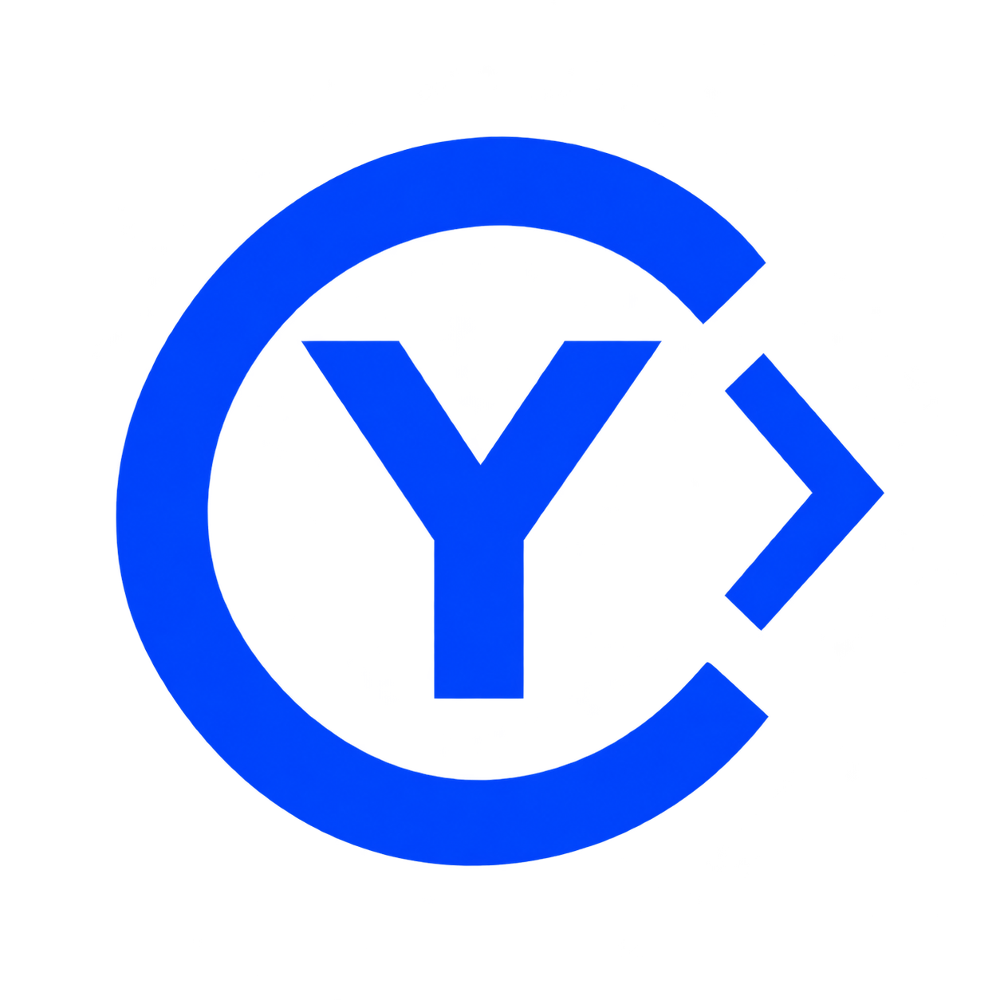

<table width="100%">
  <tr>
    <td width="300" align="left" valign="top">
      <a href="https://mrmybal.github.io/CyCode/Documentation.html#/fr/overview">Manuel</a><br>
      <a href="https://github.com/MrMybal/CyCodeIDE">Dépôt</a><br>
      <a href="VERSION.fr.md">Notes de version</a><br><br>
      <sub>README</sub><br>
      <a href="README.md">English</a> · <a href="README.fr.md">Français</a>
    </td>
    <td width="400" align="center" valign="middle">
      
    </td>
    <td width="300" align="right" valign="top">
      <p><sub>Licence de l’application</sub><br><a href="LICENSE"><strong>GPL-3.0-only</strong></a></p>
      <p><sub>Version de l’IDE</sub><br><a href="VERSION.fr.md"><strong>0.2.5</strong></a><br><strong>EN DÉVELOPPEMENT</strong></p>
      <p><a href="https://github.com/MrMybal/CyCodeIDE/releases/tag/v0.2.5"><strong>Télécharger</strong></a><br><sub>Windows x64 · installateur / portable</sub></p>
    </td>
  </tr>
</table>

<h1 align="center">CyCodeIDE</h1>

Un IDE natif pour modifier du code, explorer des projets et utiliser ses outils de développement.

> **CyCodeIDE 0.2.5 · Windows x64 · 2026-11-20**
>
> Connectez une IA par URL MCP locale avec Free, ou conservez le profil d’accès choisi.
> Consulter les [notes de version et limites](VERSION.fr.md).
> [Télécharger l’installateur ou le ZIP portable](https://github.com/MrMybal/CyCodeIDE/releases/tag/v0.2.5).

## À propos de CyCodeIDE

Écrire et parcourir du code, consulter les problèmes et prévisualiser les
modifications dans un même espace de travail. Organiser les panneaux et fenêtres
selon son projet, puis utiliser les outils de compilation, de débogage et de
gestion de versions configurés.

L’autocomplétion, la navigation et l’analyse dépendent du serveur de langage et
des outils configurés pour le projet. Le
[manuel](https://mrmybal.github.io/CyCode/Documentation.html#/fr/overview)
explique comment commencer.

## Fonctionnalités

- **Édition du code** : coloration syntaxique, annulation/rétablissement,
  JetBrains Mono, taille/zoom partagés et minicarte en option.
  Les sources de développement ajoutent la [coloration Zig/ZON et le choix du langage](Docs/SyntaxLanguages.md), sans outils sémantiques Zig intégrés.
- **Assistance au code** : autocomplétion, navigation entre symboles, diagnostics
  et aperçus des modifications proposées avec le serveur de langage configuré.
- **Analyse et inspections** : examiner les fichiers du projet, mettre l’analyse
  en pause et la reprendre, lancer des contrôles clang-tidy pour C++.
- **Grands fichiers texte** : édition UTF-8 paginée, recherche, sélection et
  enregistrement. Consulter les [limites actuelles](VERSION.fr.md).
- **Outils de projet** : panneaux de compilation, de débogage et de gestion de versions.
- **Espace de travail** : panneaux ancrables, fenêtres multiples, thèmes et
  raccourcis configurables.
- **Mises à jour** : rechercher et télécharger les nouvelles versions depuis
  l’application. Consulter le [guide des mises à jour](Docs/Updates.md).
- **Assistant intégré :** réponses progressives, annulation et historique conservé,
  avec accès configurable au projet courant. Ouvrez **Affichage → Assistant**.
- **CLI et MCP :** travaillez depuis un terminal ou une IA externe sur les
  documents courants de la fenêtre. Le MCP local utilise **Free** par défaut,
  avec connexion par URL seule ; Local contrôlé, Jeton seul et Protégé restent disponibles.
  Voir le [guide de l’assistant et de l’automatisation](Docs/AssistantMCP.fr.md).
- **Anglais et français** : langue de l’interface au choix et manuel bilingue
  disponible en ligne et hors ligne.

---

## Installation

Télécharger l’[installateur Windows x64 ou le ZIP portable](https://github.com/MrMybal/CyCodeIDE/releases/tag/v0.2.5).
L’installateur utilise un dossier par utilisateur, sans droits administrateur.
Pour la version portable, extraire tout le dossier avant de lancer `CyCodeIDE.exe`.
L’application graphique nécessite un pilote OpenGL.

Consulter les [notes de version](VERSION.fr.md) pour les limites actuelles et
l’état de validation.

### Lire le manuel

Consulter le [manuel en français](https://mrmybal.github.io/CyCode/Documentation.html#/fr/overview)
ou le [manuel anglais](https://mrmybal.github.io/CyCode/Documentation.html#/en/overview)
en ligne, ou ouvrir le manuel fourni depuis l’application.

Le manuel hors ligne ne nécessite ni serveur, ni compte, ni connexion Internet.
Conserver le dossier complet `app/Documentation/`, avec `DocData/`, à côté de
l’application.

## Sources, compilation et bibliothèques nécessaires

Outils de compilation : **CMake 3.24+**, **Python 3.11+**, **Git** et une chaîne
**C++20**. Sous Windows, utiliser les outils C++ x64 de Visual Studio 2022.
Les sources Linux/macOS nécessitent Ninja et les bibliothèques de développement
OpenGL de la plateforme ; leur état de validation figure dans les
[notes de version](VERSION.fr.md).
**Node.js 22+ et npm** génèrent le manuel fourni avec l’application.

```sh
git clone https://github.com/MrMybal/CyCodeIDE.git
cd CyCodeIDE
python app/scripts/build.py --fetch
```

Le script récupère les bibliothèques nécessaires. Sous Windows, l’application
est produite dans `runtime/build/app/Release/CyCodeIDE.exe`.
Le [guide de développement](Docs/Extraction.md) détaille le choix des dépendances,
les répertoires de compilation séparés et les commandes de validation.

---

## Licence

**CyCodeIDE utilise [GNU GPL v3 uniquement](LICENSE) (`GPL-3.0-only`).**
Voir [COPYRIGHT](COPYRIGHT). Les dépendances conservent leurs licences et notices.

### Composants natifs et interface

| Bibliothèque · sources | Licence · texte | Utilisation / périmètre |
| --- | --- | --- |
| [CyCode Core](https://github.com/MrMybal/CyCode) | [GPL-3.0-only](https://github.com/MrMybal/CyCode/blob/b902736b0edb9a76365a47778af8a223d50e5b83/LICENSE) | Services natifs de projet, documents et CLI partagés. |
| [Éditeur CyCodeReader](https://github.com/MrMybal/CyCodeReader) | [GPL-3.0-only](https://github.com/MrMybal/CyCodeReader/blob/889dd5fd8db8bfabdba4601f5d2a955723c91301/LICENSE) | API source 1 de l’éditeur graphique partagé. |
| [CyUI](https://github.com/MrMybal/CyUI) | [MIT](https://github.com/MrMybal/CyUI/blob/e8ccec0a96ed820fc46e86059e010efafcef687e/LICENSE) | Modules sélectionnés d’interface, code, comparaison et panneaux. |
| [CyMCPSDK](https://github.com/MrMybal/CyMCPSDK) | [MIT](app/licenses/CyMCPSDK.txt) | Assistant, registre natif d’outils, CLI et MCP. |
| [Dear ImGui](https://github.com/ocornut/imgui) | [MIT](https://github.com/ocornut/imgui/blob/d682dc41f58b98c9343ffbaa7d94f07e9024b3ca/LICENSE.txt) | Interface native et adaptateurs SDL/OpenGL partagés. |
| [SDL3](https://github.com/libsdl-org/SDL) | [zlib](https://github.com/libsdl-org/SDL/blob/release-3.4.18/LICENSE.txt) | Fenêtres natives, saisie et intégration à la plateforme. |
| [ImGuiColorTextEdit](https://github.com/goossens/ImGuiColorTextEdit) | [MIT](https://github.com/MrMybal/CyUI/blob/e8ccec0a96ed820fc46e86059e010efafcef687e/third_party/texteditor/LICENSE) | Éditeur CyUI ; Reader adapte des copies propres à la compilation. |
| [Lexilla / Scintilla](https://github.com/ScintillaOrg/lexilla) et [propriétés SciTE](https://github.com/mirror/scite) | [Notices permissives des composants](https://github.com/MrMybal/CyUI/blob/e8ccec0a96ed820fc46e86059e010efafcef687e/THIRD_PARTY_NOTICES.md) | Analyse lexicale, en-têtes publics et données de mots-clés ; sans interface d’éditeur Scintilla. |
| [Tree-sitter et grammaires](https://github.com/tree-sitter) | [MIT ; notices des composants](app/THIRD_PARTY_NOTICES.md) | Analyse syntaxique de l’éditeur partagé. |
| [stb_image](https://github.com/nothings/stb) | [MIT ou Unlicense](app/THIRD_PARTY_NOTICES.md) | Décodage d’images. |
| [libwebp](https://github.com/webmproject/libwebp) | [Licence de type BSD et concession de brevets](app/THIRD_PARTY_NOTICES.md) | Décodage d’images uniquement. |
| [PCRE2](https://github.com/PCRE2Project/pcre2) | [BSD-3-Clause avec exception PCRE2](app/THIRD_PARTY_NOTICES.md) | Recherche UTF-8 dans les extraits de code de Core. |
| [utf8proc](https://github.com/JuliaStrings/utf8proc) | [MIT et conditions des données Unicode](app/THIRD_PARTY_NOTICES.md) | Conversion de casse Unicode des extraits de Core. |
| [Monocypher](https://monocypher.org) | [BSD-2-Clause ou CC0-1.0](app/THIRD_PARTY_NOTICES.md) | Vérification des signatures de paquets par Core. |
| [TinyXML2](https://github.com/leethomason/tinyxml2) | [zlib](app/THIRD_PARTY_NOTICES.md) | Données XML des projets Core. |
| [libvterm](https://www.leonerd.org.uk/code/libvterm/) | [MIT](app/THIRD_PARTY_NOTICES.md) | Émulation du terminal natif. |
| [nlohmann/json](https://github.com/nlohmann/json) | [MIT](app/THIRD_PARTY_NOTICES.md) | Données et protocoles JSON natifs. |
| [JetBrains Mono 2.304](https://github.com/JetBrains/JetBrainsMono) | [SIL OFL 1.1](app/resources/fonts/JetBrainsMono-OFL.txt) | Police de code embarquée et police de repli hors ligne. |
| [Roboto](https://github.com/googlefonts/roboto-2) | [Apache-2.0](app/resources/fonts/Roboto-LICENSE.txt) | Police de repli hors ligne pour l’interface. |
| [Microsoft Codicons 0.0.36](https://github.com/microsoft/vscode-codicons) | [CC BY 4.0](app/resources/fonts/Codicons-LICENSE.txt) | Police d’icônes CyCode Controls adaptée et renommée. |

### Documentation et outils optionnels

| Bibliothèque · sources | Licence · texte | Utilisation / périmètre |
| --- | --- | --- |
| [CyDoc 0.1.0](https://github.com/MrMybal/CyDoc) | [MIT](https://github.com/MrMybal/CyDoc/blob/6ddf9a582defb2f11fbb3f992afef6f98dcadc93/LICENSE) | Lecteur hors ligne distribué avec les modules image et galerie. |
| [marked 17.0.6](https://github.com/markedjs/marked) | [MIT](https://github.com/markedjs/marked/blob/v17.0.6/LICENSE.md) | Compilation Markdown pendant la génération. |
| [PrismJS 1.30.0](https://github.com/PrismJS/prism) | [MIT](https://github.com/PrismJS/prism/blob/v1.30.0/LICENSE) | Coloration du code de la documentation pendant la génération. |
| [esbuild 0.25.12](https://github.com/evanw/esbuild) | [MIT](https://github.com/evanw/esbuild/blob/v0.25.12/LICENSE.md) | Assemblage de la documentation pendant la génération. |

Serveurs de langage, compilateurs, adaptateurs de débogage et environnements
SDK/MCP optionnels conservent les conditions de leurs composants. Ce sont des
prérequis distincts ou des paquets sélectionnés, pas des fonctions livrées
systématiquement. Les [notices tierces](app/THIRD_PARTY_NOTICES.md) précisent leur
périmètre.

Ces tableaux recensent les principaux composants sans remplacer leurs notices
transitives complètes. Conserver les textes de licence distribués, les notices
des polices et `Documentation/DocData/licenses/` avec leurs composants.

## Références et liens

- [Manuel en français](https://mrmybal.github.io/CyCode/Documentation.html#/fr/overview) · [English manual](https://mrmybal.github.io/CyCode/Documentation.html#/en/overview).
- [Dépôt des sources](https://github.com/MrMybal/CyCodeIDE) · [Notes de version et limites](VERSION.fr.md).
- [CyCode Core](https://github.com/MrMybal/CyCode) · [CyCodeReader](https://github.com/MrMybal/CyCodeReader) · [CyUI](https://github.com/MrMybal/CyUI).

<details>
<summary><strong>AI Usage</strong></summary>

- [Commencer ici : instructions du dépôt](AGENTS.md) — périmètre, guides importants et restrictions de développement.
- [Développer l’interface](app/AGENTS.md) — présentation CyUI et responsabilités des services partagés.
- [Intégrer Core](https://github.com/MrMybal/CyCode/blob/b902736b0edb9a76365a47778af8a223d50e5b83/app/Docs/CoreExtraction.md) — architecture native verrouillée et contrats source.

</details>
